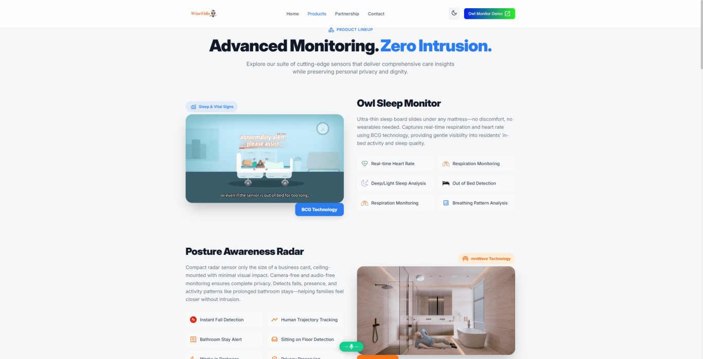
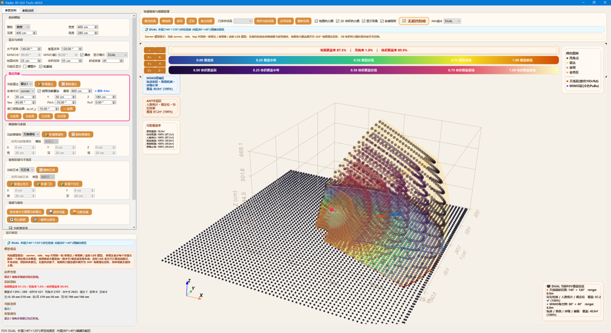

> 🏠 [返回主页](https://github.com/hhtbing) | **中文** / [English](./README_en.md)

# 👋 你好，我是 Benson

> AI 辅助全栈工程师 | AIoT 开发者 | Vibe Coding 实践者

## 🚀 关于我

电子工程背景，长期从事医疗电子、嵌入式系统与全栈开发。专注于**使用 Codex 等 AI 工具进行辅助开发（Vibe Coding）**，结合 Git、终端、Docker 快速理解陌生系统并构建各类应用。

目前正在构建自托管 AI Agent 平台、模型路由与长期记忆服务、物联网系统和开发者工具，连接硬件与软件的桥梁。

## 💼 核心能力

- 🤖 **AI 平台与模型基础设施** - Agent 编排、成果管理、模型路由、长期记忆与上下文服务
- 📱 **移动开发** - Android 原生应用、BLE 配网、跨平台方案
- 🔬 **物联网与嵌入式** - ESP32、TI 雷达、USB 协议、OTA 系统
- 🌐 **全栈 Web** - FastAPI、Express、React、Vue、Docker 部署
- 🔧 **开发者工具** - Windows 实用工具、自动化脚本、CI/CD 流水线

## 📊 项目统计

- 🎯 覆盖 **AI 平台 / IoT 嵌入式 / 移动端 / Web 全栈 / 工具开发 / 数据服务**
- 🏗️ AI Agent 平台持续扩展模型路由与跨 Agent 记忆能力
- 📱 **移动应用**已上线 Google Play
- 🔧 工具与自动化覆盖发布、文档、图标和 USB 设备管理

## 🔥 精选项目

### 🤖 [AgentMeshOS](https://github.com/hhtbing/portfolio/tree/main/projects/01-ai-platform/agentmeshos)
自托管 AI Agent 平台，支持分布式任务调度和统一成果管理。  
`Python` `FastAPI` `Nomad` `Docker` `Tailscale`

### 🧭 [Model Router](https://github.com/hhtbing/portfolio/tree/main/projects/01-ai-platform/model-router)
多模型路由与接入层，支持多 Provider、Key 池、冷却切换、健康与用量观测，以及 Responses/Chat 协议路径透传。

`Python` `FastAPI` `SQLite` `Responses/Chat`

### 🧠 [Agent Memory Service](https://github.com/hhtbing/portfolio/tree/main/projects/01-ai-platform/mcp-memory-server)
跨 Agent 长期记忆与上下文服务，支持 MCP、Hook、REST 接入，以及混合检索、知识图谱、用户画像和技能/规则管理。

`Python` `MCP` `SQLite-vec` `ONNX` `bge-m3`

### 📱 [OwlCare 系统](https://github.com/hhtbing/portfolio/tree/main/projects/02-mobile/owlcare)
智能健康监护系统，包含 Android 原生应用和自建 OTA 后台。  
项目页附产品官网、DEMO 管理看板和 Google Play 发布页三张案例截图。  
[Google Play](https://play.google.com/store/apps/details?id=com.wisefido.owlmonitor) | `Kotlin` `BLE` `FastAPI`

### 🔬 [OTA-QL 系统](https://github.com/hhtbing/portfolio/tree/main/projects/03-iot-embedded/ota-system)
雷达设备 OTA 管理的全栈方案，支持双协议和批量固件管理。  
`Go` `MQTT` `Python` `Docker`

### 🌐 [Owl Website](https://github.com/hhtbing/portfolio/tree/main/projects/04-web-business/owl-website)
企业官网系统，包含后台管理和内容发布功能。  
[https://www.wisefido.com/](https://www.wisefido.com/) | `FastAPI` `Vue` `Docker`

### 🛒 [Three Dogs 电商独立站](https://github.com/hhtbing/portfolio/tree/main/projects/04-web-business/three-dogs)
面向巴西市场的多语言 WooCommerce 家居纺织品独立站，覆盖首页、分类 Mega Menu、筛选、购物车和结算前流程，项目页附 4 张前台截图。  
`WordPress` `WooCommerce` `Woodmart` `PHP`

### 🌐 [AWRL6844 雷达网关](https://github.com/hhtbing/portfolio/tree/main/projects/03-iot-embedded/radar-gateway)
基于 ESP32 的网关，将 TI 雷达桥接到 Wi-Fi/TCP，带 Web 管理界面。  
`ESP32` `Node.js` `WebSocket`

## 📚 项目分类

### 🤖 AI 与平台类
- [AgentMeshOS — 自托管 AI Agent 平台](https://github.com/hhtbing/portfolio/tree/main/projects/01-ai-platform/agentmeshos)
- [Model Router — 多模型路由与接入层](https://github.com/hhtbing/portfolio/tree/main/projects/01-ai-platform/model-router)
- [Agent Memory Service — 跨 Agent 长期记忆与上下文服务](https://github.com/hhtbing/portfolio/tree/main/projects/01-ai-platform/mcp-memory-server)
- [Codex Host Bridge — 远程开发桥接](https://github.com/hhtbing/portfolio/tree/main/projects/01-ai-platform/codex-bridge)

### 📱 移动应用类
- [OwlCare — 智能监护系统（Android 应用 + 配置工具 + OTA 后台）](https://github.com/hhtbing/portfolio/tree/main/projects/02-mobile/owlcare)

### 🔬 物联网与嵌入式
- [OTA-QL — 雷达 OTA 管理系统](https://github.com/hhtbing/portfolio/tree/main/projects/03-iot-embedded/ota-system)
- [AWRL6844 雷达网关](https://github.com/hhtbing/portfolio/tree/main/projects/03-iot-embedded/radar-gateway)
- [TI 雷达开发平台（历史参考）](https://github.com/hhtbing/portfolio/tree/main/projects/03-iot-embedded/ti-radar-dev)

### 🌐 Web 与业务系统
- [Three Dogs — 多语言 WooCommerce 家居电商独立站](https://github.com/hhtbing/portfolio/tree/main/projects/04-web-business/three-dogs)
- [Owl Website — 企业官网系统](https://github.com/hhtbing/portfolio/tree/main/projects/04-web-business/owl-website)
- [OwlFront Mock — 前端演示系统](https://github.com/hhtbing/portfolio/tree/main/projects/04-web-business/owl-front-mock)
- [Codex Mobile Control — 移动端控制](https://github.com/hhtbing/portfolio/tree/main/projects/04-web-business/codex-mobile-control)

### 🔧 工具与实用程序
- [DIR-MOVE-TOOLS — 目录迁移工具](https://github.com/hhtbing/portfolio/tree/main/projects/05-tools/dir-move-tools)
- [USB-MIC-MUTE — USB 麦克风控制](https://github.com/hhtbing/portfolio/tree/main/projects/05-tools/usb-mic-mute)
- [HEIC-TOOLS — 图片格式转换](https://github.com/hhtbing/portfolio/tree/main/projects/05-tools/heic-tools)
- [PDF-MD-TOOLS — 文档转换工具](https://github.com/hhtbing/portfolio/tree/main/projects/05-tools/pdf-md-tools)
- [Icon-data — 图标数据管理](https://github.com/hhtbing/portfolio/tree/main/projects/05-tools/icon-data)

### 📊 数据与医疗信息化
- [FHIR Coding Dictionary — 医疗编码字典](https://github.com/hhtbing/portfolio/tree/main/projects/06-data/fhir-coding-dictionary)

### 🎮 其他项目
- [Game Snake — 微信小游戏](https://github.com/hhtbing/portfolio/tree/main/projects/07-others/game-snake)
- [Music MuseScore — BGM 批量生成工具](https://github.com/hhtbing/portfolio/tree/main/projects/07-others/music-musescore)

## 🛠️ 技术栈

### 后端开发
- Python (FastAPI, SQLAlchemy, Pydantic)
- Go (MQTT, HTTP Server, TCP)
- Java (Android SDK)
- Node.js (Express, WebSocket)

### 前端开发
- Vue.js, React
- JavaScript/TypeScript
- Jetpack Compose (Android)
- HTML5/CSS3

### 嵌入式 & IoT
- ESP32 (ESP-IDF)
- TI 毫米波雷达
- BLE/Wi-Fi 协议
- MQTT, TCP/IP
- USB 协议栈

### 基础设施
- Docker, Nomad
- PostgreSQL, SQLite, Redis
- MCP, Hook, REST
- SQLite-vec, ONNX, bge-m3
- Nginx, Tailscale
- Git, CI/CD (GitHub Actions)

## 📫 联系方式

- 📧 Email: hhtbing@foxmail.com
- 🔗 GitHub: [@hhtbing](https://github.com/hhtbing)

---

*使用 AI 辅助开发（Vibe Coding）构建实用系统，专注解决真实问题。*
